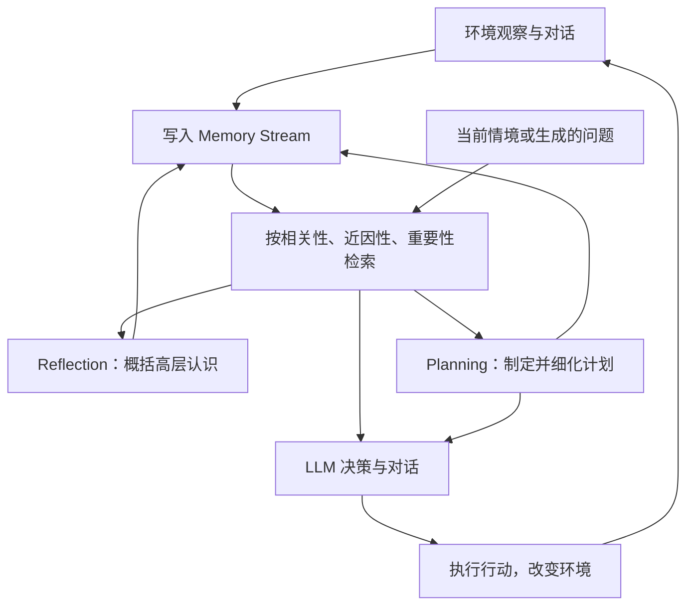

# Generative Agents 精读笔记与复现方案

**对应课题：融合语义、时效与任务相关性的智能体记忆检索重排序方法研究**  
**作者：Joon Sung Park 等；UIST 2023；arXiv:2304.03442v2。**  
**阅读与源码核验日期：2026-11-13。**  
**源码固定版本：`fe05a71d3e4ed7d10bf68aa4eda6dd995ec070f4`。**

这份笔记以你提供的工作计划为研究背景，围绕六个问题展开，并补充可操作的复现边界、实验协议与源码核验结果。文中的论文页码是英文原 PDF 的页码，不是上一轮中文译本的页码。

证据标记：**【论文】**表示原文明确陈述；**【源码】**表示本次检查指定 commit 得到；**【实测】**仅表示本次局部函数实验；**【建议／推导】**表示面向你课题的研究判断，不是作者结论。没有运行完整 Smallville，也没有获得原论文的数值复现结果。

## 先给判断

**这篇论文应当成为你的“多因子记忆检索机制基线”，但不必把完整小镇模拟当作本阶段的复现目标。**

它最适合借用的内容有三项：

1. 用语义相关性、访问近因性与重要性组合的可解释打分机制。
2. 用相同记忆快照比较不同方法的控制变量思想。
3. 带创建时间、最近访问时间、重要性和推理证据的记忆表示。

它不是一个已经证明“三项线性打分最优”的检索论文，也没有提供可以直接计算 Recall@K、MRR、NDCG 的标准记忆检索金标测试集。它主要证明的是：**记忆、规划和反思组成的架构有助于生成可信的人类行为。**

尤其要注意：**论文描述与当前公开源码存在实质差异。** 如果直接运行仓库，不应把实际执行的排序函数自动等同于论文公式。建议保留两个明确命名的版本：

- `GA-paper`：按论文 §4.1 实现，作为主要文献基线。
- `GA-code@fe05a71`：按本次固定源码的行为实现，作为实现核验／附加对照。

它们都不等于“2023 年原始实验环境的完全复现”。

---

## 1. 它解决什么问题？能否与你的问题对齐？

### 1.1 原论文的问题定义

【论文：§1、§4，原 PDF pp.2–3、8–12】大语言模型可以在一个时刻给出看起来合理的行为，但难以保证一个角色在长时间互动中的连贯性：它需要记住以前遇见谁、知道什么、打算做什么，并根据后续事件调整行为。

以 Klaus 为例，如果每次只根据“现在几点、角色是谁”询问下一步行动，模型可能在 12:00、12:30、13:00 接连安排午饭。单步合理不代表整段行为合理。

论文的核心任务可写为：

```text
输入：角色设定 + 当前感知 + 累积经历 + 既有计划
输出：与角色身份、过去经历和未来安排相协调的行动／对话
约束：记忆持续增长，语言模型上下文有限，环境不断变化
主要目标：行为可信性 believability
```

记忆检索是支撑上述目标的子问题：从不断增长的经历中，找出此刻应该进入 LLM 上下文的内容。

### 1.2 你的问题定义

【建议】把你的课题具体化为：

```text
输入：当前查询 q、任务状态 z、查询时点 t、可见记忆 M，或召回候选集 C
输出：优先包含有效、支持当前任务的证据的有序记忆列表
约束：Top-K／token 预算、延迟、旧版本与新版本共存
主要目标：证据排序质量，以及下游回答或任务完成质量
```

如果输入是候选集 C，则你研究的是 reranking；如果直接给全部记忆 M 打分，则是完整检索器。论文 §4.1 的表述及已核验的 `new_retrieve` 更接近“对可用记忆全量打分再取前列”，并不是显式训练一个 Cross-Encoder，也不是标准的“向量召回 Top-N → 独立重排 Top-K”两阶段系统。

### 1.3 对齐与不对齐

| 维度 | Generative Agents | 你的课题 | 判断 |
|---|---|---|---|
| 共同困难 | 历史很多，不能全部送进上下文 | 同样如此 | 高度对齐 |
| 语义因子 | 查询与记忆 embedding 的 cosine similarity | 语义相似度 | 可直接做基线 |
| 时间因子 | 距离最近访问的时间 | 还涉及事实更新、有效期、任务阶段 | 只部分对齐 |
| 重要性 | 对角色而言是否重要、是否触动人心 | 对任务是否有帮助 | 不能画等号 |
| 最终目标 | believable behavior | 正确证据、有效记忆、任务完成 | 评测不可直接照搬 |
| 场景 | 25 个虚构居民，连续两个游戏日 | 多轮任务、用户事实、旧／冲突记忆 | 需要改建数据 |
| 方法贡献 | 完整智能体架构 | 记忆重排序模块 | 应缩小复现范围 |

**可以在论文中这样定位：**“Generative Agents 提供了融合相关性、近因性和重要性的记忆检索机制，但其时间项侧重访问近因性，评估目标侧重社会行为可信性。本研究将关注点放在任务驱动检索中证据的有效性与排序质量。”

不要写成：“Generative Agents 没有考虑任务／情境。”它会利用当前情境生成查询，并用任务和计划引导行为。准确的区别是：**其检索评分没有将任务效用作为独立因子建模并单独验证。**

## 2. 核心机制是什么？

### 2.1 系统闭环

【论文：§4，图 5–7】



这里有两个对你的研究很重要的反馈环：

- 检索到的记忆会影响未来行为，也会影响之后写入哪些记忆。
- 反思是由已有记忆生成的新记忆，后续检索可以再次取出它。

因此，直接在开放式模拟中比较两个检索器，最终差异会混合“排序差异”和“记忆库已分化”的影响。固定快照评估更适合作为你的主实验。

### 2.2 论文的记忆数据结构

【论文：§4.1–4.3】最基本字段是自然语言描述、创建时间戳、最近访问时间戳。重要性在记忆生成时计算；检索用到 embedding；反思保存指向证据记忆的指针；计划包含地点、开始时间和持续时间。

一个便于理解的逻辑表示如下，它是对论文的整理，不是仓库原生 JSON schema：

```python
Memory:
    id: str
    text: str
    kind: observation | reflection | plan
    created_at: datetime
    last_accessed_at: datetime
    importance: int           # 1..10
    embedding: vector
    evidence_ids: list[str]    # 主要用于 reflection
    plan_metadata: optional   # 地点、起始时间、时长
```

【源码：S3】实际类型是 `event / thought / chat`，不是上面三个标签的一一对应。反思通常存为 thought；日程也存在 scratch 中，部分规划描述作为 thought 写入记忆。不能只搜索一个叫 `plan` 的类型就断言代码没有保存计划。

实际 `ConceptNode` 字段包括：

| 字段 | 含义 |
|---|---|
| `node_id`, `node_count`, `type_count` | 标识和计数 |
| `type` | event / thought / chat |
| `depth` | 推理层级；thought 可由证据深度推导 |
| `created`, `expiration`, `last_accessed` | 创建、过期、最近访问时间 |
| `subject`, `predicate`, `object` | 事件的主体—谓词—客体 |
| `description` | 自然语言描述 |
| `embedding_key` | embedding 字典中的键 |
| `poignancy` | 重要性分数 |
| `keywords` | 关键词索引 |
| `filling` | 依类型承载证据节点 ID、对话等附加内容 |

【源码】长期记忆是 Python 列表／字典组织的 `AssociativeMemory`，通过 `nodes.json`、`embeddings.json`、`kw_strength.json` 持久化，不应笼统说成“作者使用了某种向量数据库”。另有空间树和 scratch，负责环境知识与当前状态。

### 2.3 检索公式：按论文定义

设记忆为 m，查询为 q，当前模拟时间为 t。

**相关性：**

\[
R(m,q)=\frac{e_m^\top e_q}{\|e_m\|\|e_q\|}
\]

表示语义向量方向的一致程度，不直接表示“这条信息是否足以解决当前任务”。

**近因性：**

\[
C(m,t)=0.995^{\Delta h(m,t)},\quad
\Delta h(m,t)=\frac{t-last\_accessed(m)}{1\ \text{hour}}
\]

【论文】小时是**沙盒游戏小时**。依据是上次访问／检索，而非创建时间。将其改成 `now - created_at` 就是一个变体。

**重要性：**

\[
I(m)=\operatorname{LLMScore}(m)\in\{1,2,\ldots,10\}
\]

Prompt 的量尺是：1 为刷牙、铺床等日常琐事；10 为分手、被大学录取等高度触动人的事件。它偏向角色生命经历的显著性，不是事实可靠度或当前任务相关度。

三项分别在参与评分的记忆集合上做 min-max normalization：

\[
\widehat{x}_i=\frac{x_i-\min_j x_j}{\max_j x_j-\min_j x_j}
\]

再计算：

\[
S_{GA}(m,q,t)=\alpha_C\widehat C+\alpha_I\widehat I+\alpha_R\widehat R,
\quad \alpha_C=\alpha_I=\alpha_R=1.
\]

最后按分数降序，将高分、能够装入上下文窗口的记忆放进提示。

【说明】论文没有给出零极差等工程边界细节，也没有规定所有使用位置统一一个 K。源码对零极差设为 0.5（目标区间为 [0,1] 时）。你实现 `GA-paper` 时可采用此约定，但应说明来自实现约定，而不是论文公式独自确定的结果。

### 2.4 重要性、语义与任务效用要分开

| 记忆 | 可能语义相似 | 可能对当前任务有用 | 可能“情感重要” |
|---|---|---|---|
| “我最喜欢听爵士乐” | 与旅行查询低 | 订火车票时通常低 | 因角色而异 |
| “我的证件姓名已经改成 B” | 与“下单机票”未必很高 | 非常高，会影响出票 | 未必高 |
| “上个月我失恋了” | 与“预订酒店”通常低 | 一般低，除非任务另有要求 | 可能很高 |
| “我的膝盖近期受伤，不能爬楼” | 与“挑选酒店”字面距离较远 | 高，应考虑电梯／楼层 | 可高可低 |

【建议】工作计划中的“不吃辣对订机票有用”需进一步限定：只买机票且不选择机餐时，它不一定有用；若任务状态包括预订机餐，或下一步已明确安排订餐，才有明确效用。**不能把“可能将来某天用得到”都标成当前任务相关，否则任务相关性会失去可检验的边界。**

### 2.5 论文版检索伪代码

```python
def retrieve_paper(query, memories, now, token_budget):
    # memories 是在当前时点真实可见的记忆快照
    if not memories:
        return []
    query_vec = embed(query)
    recency = {}
    relevance = {}
    importance = {}
    for m in memories:
        hours = (now - m.last_accessed_at).total_seconds() / 3600
        assert hours >= 0
        recency[m.id] = 0.995 ** hours
        relevance[m.id] = cosine(query_vec, m.embedding)
        importance[m.id] = m.importance

    C = minmax(recency, constant_value=0.5)
    R = minmax(relevance, constant_value=0.5)
    I = minmax(importance, constant_value=0.5)
    scores = {m.id: C[m.id] + R[m.id] + I[m.id] for m in memories}
    ranked = stable_sort_desc(memories, scores)  # 固定并列规则，记录规则
    selected = pack_under_budget(ranked, token_budget)

    # 在动态运行模式中更新；离线独立查询评估应使用快照副本
    for m in selected:
        m.last_accessed_at = now
    return selected
```

【建议】`pack_under_budget` 是你需要明确定义的实现环节：依次加入、超预算则停止，还是跳过过长记录继续选？不同选择都会影响结果。可先做固定 K 的排序实验，再做统一 token 预算的下游实验，分别命名。

### 2.6 写入、反思与规划更新

【论文：§4.2】反思流程：

```python
on_new_observation(observation):
    m = make_memory(observation)
    m.importance = score_once_with_llm(m.text)
    m.embedding = embed(m.text)
    memory_stream.append(m)
    accumulated_importance += m.importance

    if accumulated_importance > 150:
        recent = latest_100_records(memory_stream)
        questions = llm_generate_questions(recent, count=3)
        for question in questions:
            evidence = retrieve(question)
            insights = llm_infer_with_evidence_ids(evidence, count=5)
            for insight in insights:
                store_reflection(insight.text, insight.evidence_ids)
        reset_reflection_accumulator()
```

这里是论文级概括；严格边界是论文写“超过阈值”，当前代码用剩余计数器 `<= 0` 触发，相当于累计达到阈值。阈值边界差异需要写在复现记录中。

反思包含三件事：提出问题、检索支持证据、生成并保存带证据的高层结论。反思还能引用已有反思，形成层次结构。

【论文：§4.3、附录 A】规划由粗到细：一天 5–8 个粗粒度安排 → 小时级 → 5–15 分钟级动作；只在需要时细化近期计划。每个时间步观察环境，决定继续、反应或重规划；若涉及他人则生成对话。

【对课题的启发】重排序对象可能不仅是原始事实，还包括推断和计划。应保存 `kind` 和证据链：一条反思语义上很相关，不代表它比原始用户确认更可靠。你的第一阶段实验可先限制为原始事实，避免把推理误差与排序误差混在一起。

## 3. 关键参数怎么定？能为你的权重提供什么辩护？

### 3.1 论文中明确给出的参数

| 参数 | 论文数值／规则 | 来源 | 如何得到？能否声称最优？ |
|---|---|---|---|
| recency 衰减因子 | 0.995／游戏小时 | §4.1，p.9 | 固定设置；未报告搜索程序或最优性证明 |
| 三项权重 | 1、1、1 | §4.1，p.9 | 等权固定设置；不是学习得到 |
| importance 分值 | 1–10 整数，LLM Prompt 评分 | §4.1，p.9 | LLM 在写入时生成；不是排序权重训练 |
| 归一化 | 分项 min-max 到 [0,1] | §4.1，p.9 | 固定规则 |
| 反思触发阈值 | 新近事件重要性累计超过 150 | §4.2，p.10 | 固定阈值；未报告调参依据 |
| 反思问题生成输入 | 最近 100 条记录 | §4.2，p.10 | 固定设置 |
| 反思问题数 | 3 | §4.2，p.10 | 固定设置 |
| 洞见数量 | 每次对应提示要求 5 条 | §4.2，p.10 | 固定设置 |
| 粗计划 | 5–8 块 | §4.3，p.11 | 规划粒度规则 |
| 细计划 | 先小时级，再 5–15 分钟级 | §4.3，p.11 | 规划粒度规则 |
| 主模型 | ChatGPT / gpt3.5-turbo | §4，p.8 | 原论文使用的底层模型 |
| 取多少记忆 | 在上下文容量内取高分记录 | §4.1，p.9 | 论文没有给出全局统一 Top-K 数值 |

**准确表述：作者采用固定的人工设定超参数，但论文未披露系统性的调参过程。** 不应进一步编造为“在验证集上手调到最好”，也不能写成“通过强化学习学到了权重”。

### 3.2 0.995 到底意味着什么？

【推导，非作者实验】原始近因性分数约为：

- 距上次访问 1 小时：0.995。
- 24 小时：0.88665。
- 48 小时：约 0.786。
- 240 小时：0.30029。
- 原始分数半衰期：`ln(0.5) / ln(0.995) ≈ 138.28 小时 ≈ 5.76 天`。

这个解释仅针对未归一化的 C。它不代表“5.76 天后记忆只剩一半排序影响”，更不代表记忆事实过期。

**一个容易漏掉的性质：**固定候选集内，如果所有记忆的 last_accessed 都不变，而时间统一推进 δ，则所有 C 同时乘以 `0.995^δ`。min-max 后，这个共同因子会抵消：

\[
\frac{aC_i-aC_{min}}{aC_{max}-aC_{min}}
=\frac{C_i-C_{min}}{C_{max}-C_{min}}.
\]

因此，在候选集固定、访问时间不变且不考虑数值下溢时，**单纯让时钟向前走，不会改变归一化近因性分数，也不会使它在加权和中的相对作用自然减弱。** 相对次序、候选集或访问记录发生变化才会产生变化。对于真正的“过期失效”，单靠这个项不够。

### 3.3 等权并不等于三项同样重要

【推导】min-max 让值域一致，但不保证分布、噪声、校准程度和决策贡献一致。例如，候选语义分数只在 0.800–0.801 之间变化，归一化后也会被拉到 0–1。很小的语义差异可能被放大到和很大的时间差异相同的量级。

归一化结果还依赖候选集。对全量记忆归一化，与只对向量召回的 Top-50 归一化，可能产生不同最终排名。因此，“复用了同一个公式”并不自动意味着同一个基线。

### 3.4 源码与论文差异：必须单列

【源码：S1–S5，固定 commit，不能外推到论文当年的全部运行配置】

| 项目 | 论文写法 | 本次检查的源码／配置 | 对复现的影响 |
|---|---|---|---|
| recency 指数 | 距最近访问的小时数 | `extract_recency` 使用列表序号 i，`decay ** i` | 不再反映实际经过小时数 |
| recency 排序方向 | 最近访问分数高 | `new_retrieve` 按 `last_accessed` 升序排列，再给靠前项更高衰减值 | 在该路径上，较早访问项得到更高 recency；与论文目标相反 |
| 加权系数 | 三项等权 | `gw=[0.5,3,2]`，对应 recency、relevance、importance，另乘 scratch 权重 | 当 scratch 权重全为 1 时有效系数为 0.5、3、2 |
| 衰减默认值 | 0.995 | `Scratch` 类默认 0.99；已检查的 Isabella 初始 JSON 是 0.995 | 实际值需看加载后的配置，不能只读类定义 |
| 反思阈值 | 150 | 类默认 150；已检查的 Isabella 初始 JSON 是 250 | 不能声称仓库所有运行均为 150 |
| 反思输入条数 | 最近 100 条 | `generate_focal_points` 使用 `importance_ele_n` 截取 | 不是固定 100 条；需核验计数来源 |
| Top-K | 上下文容量约束 | `new_retrieve(..., n_count=30)` 默认 30 | 调用方可改；不代表论文全局 K=30 |
| 过期字段 | 论文未给出系统化版本有效性机制 | 有 `expiration`，反思可写入 30 天后过期，但该检索函数未据此过滤 | 有字段不代表检索执行失效规则 |
| 访问时间持久化 | 逻辑上维护最近访问 | `save` 不写 `last_accessed`，加载构造时重置为 `created` | 重新加载会丢失这部分访问历史 |
| 记忆候选类型 | 观察／反思／计划 | `new_retrieve` 遍历 event + thought，过滤 embedding_key 含 idle 的项，不直接遍历 chat | 不能把全部 JSON 节点直接作为同一候选集合 |

特别提醒：仓库还有一个名为 `retrieve` 的函数，通过 subject／predicate／object 的关键词索引取相关事件与 thoughts。**你要复现的三因子打分主要在 `new_retrieve`，不能只看文件里第一个同名概念函数。**

源码注释提到未来权重或可学习，包括 RL 类方法；这只是未来设想。实际赋值仍是固定常数。

### 3.5 本次做了什么局部实测？

【实测】从固定版本的 `retrieve.py` 用 Python AST 抽取原函数执行；embedding 替换为固定合成向量，不访问 LLM API。构造两条 importance 相同、semantic relevance 相同的记忆，仅访问时间不同。

| 记忆 | 距访问时间 | 论文原始 C | 源码原始 C | 源码 min-max C |
|---|---:|---:|---:|---:|
| m0 | 24 小时 | 0.8866535 | 0.995 | 1 |
| m1 | 1 小时 | 0.995 | 0.990025 | 0 |

`new_retrieve(..., n_count=1)` 选择了 m0。把 m0 改为 240 小时前，源码原始和归一化 C 完全不变，仍选择 m0；论文原始 C 则变为 0.300289。

还确认了：被选中节点的 last_accessed 会改为当前时间；即使节点 expiration 已经过期，该路径仍能选择它；所有值相等时归一化为 0.5。

**这证明指定函数在特定输入下的行为，不证明整篇论文的实验无效，也不能推定 2023 年实验跑的就是本次 commit。**

### 3.6 你的权重应该怎样辩护？

【建议】分四层说清楚：

1. 文献基线：保留 `GA-paper` 的固定等权和 0.995，不用测试集调整。
2. 公平调参对照：增加 `GA-paper-tuned`，在同一开发集、同等预算下调权重与时间尺度，避免只战胜未经调优的弱基线。
3. 你的方法：任务项权重、时间参数在开发集选择，锁定后只在测试集报告一次主结果。
4. 敏感性：画权重与时间尺度变化对 NDCG@K、过时记忆错误率的影响，检查是否只在一个点有效。

初期可设非负权重和为 1，在步长 0.25 的小网格上搜索；选择一个预先规定的主指标，例如 dev NDCG@5。这个网格是建议，不是原论文设置。数据只有 10 个任务时，不宜声称学到了稳健权重；它们更适合流程验证。

如果 importance 来自 LLM，要固定模型、Prompt、运行配置并缓存分数，所有对照共用同一份结果。**importance 由模型生成，不等于线性融合权重由数据学习。**

## 4. 在什么数据、什么指标上评测？能借什么？

### 4.1 原论文的两类评测

【论文：§6–7，原 PDF pp.13–16；附录 B，pp.21–22】

| 项目 | 受控评估 | 端到端评估 |
|---|---|---|
| 数据来源 | Smallville 两个游戏日后的智能体与记忆 | 25 个智能体连续互动两个游戏日 |
| 评估单位 | 智能体对访谈问题的回答 | 社区中的信息、关系、协调行为 |
| 问题 | 5 类 × 每类 5 题，共 25 个问题模板 | 参选消息、派对消息、彼此认识、到场情况 |
| 人类评估 | 100 名评估者，被试内比较五种条件 | 访谈并检查记忆流，验证是否确有证据 |
| 主要指标 | 回答可信性排序，转为 TrueSkill | 知情比例、网络密度、派对到场数 |
| 统计分析 | Kruskal-Wallis、Dunn、Holm-Bonferroni | 主要为描述性测量 |

受控评估的五种条件是：

1. 完整架构。
2. 无 reflection：保留 observation 和 plan。
3. 无 reflection、无 planning：仅 observation。
4. 无 observation、reflection、planning：不能访问记忆流。
5. 人类众包工作者扮演该智能体后撰写回答。

这些是**记忆／架构组件消融**。它们不是 `只语义`、`语义+时间`、`语义+时间+重要性` 的评分因子消融。

### 4.2 结果应该如何读？

| 条件 | TrueSkill μ | σ |
|---|---:|---:|
| 完整架构 | 29.89 | 0.72 |
| 无 reflection | 26.88 | 0.69 |
| 无 reflection、planning | 25.64 | 0.68 |
| 人类众包 | 22.95 | 0.69 |
| 无 observation、reflection、planning | 21.21 | 0.70 |

【论文】总体检验 `H(4)=150.29, p<0.001`；除人类众包与完全消融基线这一对之外，其余两两差异显著。论文报告完整架构与完全消融基线的标准化效应量 `d=8.16`。

**这些数值不能解释为“检索准确率 29.89%”或“检索提高 8 倍”。** TrueSkill 是由相对偏好排序估计的评分，σ 也不是你以后 NDCG 实验的标准差。论文的众包基线不代表专家的人类上限。

端到端结果：

- 知道 Sam 参选：1/25（4%）→ 8/25（32%）。
- 知道 Isabella 派对：1/25（4%）→ 13/25（52%）。
- 关系网络密度：0.167 → 0.74，其中 `density=2|E|/[|V|(|V|-1)]`。
- 453 条关于是否认识他人的回答中，6 条（1.3%）被判定为幻觉。
- 12 位受邀智能体中 5 位到场；7 位未到，3 位有安排冲突，4 位虽有兴趣却未形成到场计划。

这些结果支持信息传播、关系形成与一定协调能力；不直接支持检索排名最优，也不衡量过时信息处理。

### 4.3 原论文最值得借用的协议

【论文】各消融条件使用同一完整架构模拟中积累的记忆，再限制能访问的记忆类型，以免不同模拟轨迹使比较失控。

【建议】对应到你的实验：**固定记忆快照、候选池、查询、时间、embedding、重要性和下游模型，只换重排序器。** 这是最有价值的可借鉴设计。

可借用附录 B 的问题类别，但要改造成带证据的任务：

| 原类别 | 你可以构造的问题 | 所需新标注 |
|---|---|---|
| Self-knowledge | 当前有效地址／偏好是什么？ | 最新有效事实及旧版本 |
| Memory | 谁通知了某项变更？ | 原始消息 ID、来源 |
| Plans | 某日某时应该执行什么？ | 有效计划与改期记录 |
| Reactions | 当前任务约束变化后该怎么做？ | 决策所需约束和证据 |
| Reflections | 综合多条信息得出什么结论？ | 多证据支持集合；难度更高 |

不能把原论文某个智能体的自然语言回答直接当成 gold answer。附录 B 是示例，其中可能包含智能体自己的错误或不一致，不是人工保证正确的标准答案表。

### 4.4 仓库数据能不能直接借？

【源码／仓库核验】README 说明存在 `base_the_ville_n25`（25 人）和 `base_the_ville_isabella_maria_klaus`（3 人），以及初始历史 CSV 和回放功能。本次核验看到 storage 中有这些基础目录及若干 3 人模拟存档。

实际读取结果：

- `base_the_ville_n25/.../Isabella Rodriguez/.../nodes.json` 是空对象 `{}`。基础角色配置不是完整两天实验记忆；不能仅复制这个文件就开展排序评测。
- 一个已保存的 `July1_the_ville_isabella_maria_klaus-step-3-20` 中，Isabella 的 nodes.json 含 912 个节点，包含 event、thought、chat，可用于理解真实记忆形态。
- 该存档不能据目录名就认定为论文的 25 人、两天评估集。
- 本次没有核实到配套的标准 `query → gold memory IDs`、官方检索 train/dev/test 划分及完整人类评估排名文件。不要把“未核实到”写成“仓库绝对不存在”。

仓库根 LICENSE 是 Apache-2.0；若再发布素材或数据，还应检查相关文件的第三方授权说明。代码授权不自动涵盖所有外部美术资产。

**结论：能借机制、示例记忆与访谈模板；要做你的主要排名实验，还需自己整理查询、有效时间、证据标注和切分。** LoCoMo、LongMemEval 可按工作计划继续调研，本笔记没有核验其当前版本、许可证或现成证据标注完备性，不能在这里预先保证“下载即可直接算所有检索指标”。

## 5. 它没做什么？哪些是你的机会？

### 5.1 可以明确指出的边界

| 边界 | 证据／原因 | 对你可能有用的方向 |
|---|---|---|
| 没单独验证三项排序因子的贡献 | §6 消融的是 observation／plan／reflection | 做 factor ablation，区分各打分项贡献 |
| 没报告权重、衰减率的系统搜索 | §4 给固定值；§8.2 提出未来改进检索函数 | 用开发集校准及敏感性分析 |
| recency 不是事实有效性 | 依最近访问计算 | 区分访问时间、事实发生时间、有效时间 |
| 没有系统化版本替代评估 | 没有旧地址／新地址的专门协议 | 构造更新、撤销、临时例外、历史查询 |
| 没独立建模任务效用分数 | relevance 主要以 embedding cosine 实现 | 将任务状态纳入评分，并与语义项分离 |
| 没有检索金标指标 | 主指标是行为可信性 | 加 Recall、MRR、NDCG 与证据可追溯性 |
| 长期稳健性证据有限 | 仅两个游戏日；§8.2 明确承认 | 延长时间跨度、加入多次事实更新 |
| 成本较高 | §8.2：两天模拟耗时数天、数千美元 token | 离线可缓存排序，报告成本／延迟 |
| 反思可能传播错误 | §6.5 润饰记忆、检索片段不完整 | 记忆来源、证据链、推断置信度 |

**研究机会不是创新性证明。** 这些不足说明值得研究，但需继续与 Mem0、Zep、A-MEM、MemGPT 及专门 reranker 文献比较，才能判断哪些已被解决。

### 5.2 原文中的失败案例为何与你有关？

【论文：§6.5，p.15】Tom 记住“要在派对讨论选举”，却没检索到“派对确实举办”的邀请，因此知道去派对后该做什么，却不确定派对是否存在。

这不只是缺少一个高分结果，也涉及**证据组合完整性**：排第一的片段可能正确，却不足以回答问题。以后可增加多证据覆盖率，而不只 MRR。

Isabella 给“Sam 将参选”的记忆补上“明天会宣布”，是生成性润饰；重排序器可能通过选择原始证据降低风险，但不能保证彻底解决 LLM 幻觉。不要把所有错误都归因于检索，也不要承诺重排即可修复所有幻觉。

### 5.3 Related Work 给出的定位

【论文：§2.2–2.3，pp.3–4】传统认知架构和规则智能体受到手工程序知识限制；已有 LLM 方法常只处理当前上下文，或使用静态知识库／简单摘要。作者把重点推进到动态经历、检索、反思和计划的结合。

你可以继续沿着“动态经历”的问题往下推进：**一条记忆可能仍然语义相关，却已经不适用于当前时间和任务。** 这比简单把“时间、任务”两个标签塞进公式更有研究价值。

## 6. 和你的课题什么关系？具体复现什么？

### 6.1 建议的范围分层

| 层次 | 做什么 | 本阶段建议 |
|---|---|---|
| A：评分机制 | 语义、访问近因性、重要性、归一化、加权、Top-K | 必做，主基线 |
| B：固定记忆问答 | 相同快照与提示，只换选入的记忆 | 主排序跑通后做 |
| C：动态记忆写入 | 访问时间更新、重复检索、更新事实 | 用简化任务环境做 |
| D：reflection 与 planning | 重现高层推断与日程闭环 | 理解机制，暂不作主要实现 |
| E：完整 Smallville | Phaser、Django、地图、25 个角色两天模拟 | 不作为当前六周任务的前置条件 |

你可以报告“复现 Generative Agents 的 memory retrieval scoring mechanism”，不要在仅有 A 层时报告“完整复现 Generative Agents”。

### 6.2 基线组合：你的现有三方案还缺一个对照

工作计划中的“语义 → 语义+时效 → 语义+时效+任务标签”很好地验证你的构想，但如果把 GA 作为最直接文献基线，需要补上 **importance**。

| 名称 | 分数 | 目的 |
|---|---|---|
| Semantic | R | 最基本基线 |
| Semantic+Recency | R + C | 隔离访问近因性影响 |
| GA-paper | R + C + I，等权，按论文定义 | 忠实文献机制基线 |
| GA-paper-tuned | 同三项，在 dev 调参 | 检查提升是否只是调参收益 |
| GA-code@fe05a71 | 当前源码顺序衰减与有效权重 | 实现差异核验，作为附加结果 |
| Task extension | 相同基础项 + T(q,z,m) | 隔离任务相关性贡献 |
| Validity extension | 相同基础项 + 有效性处理 | 隔离时间有效性贡献 |
| Full proposal | 任务相关性 + 有效性等最终设计 | 完整方法 |

第一版可只实现前 3 项和一个任务扩展；正式实验再补调优与消融。

若你的最终设计删除 importance，就还应比较 `R+C+T` 与 `R+C+I+T`，解释是否有必要保留重要性，而不是默认“任务项就是重要性的另一种叫法”。

### 6.3 复现的工程结构

```text
memory-rerank/
  data/
    memories.jsonl          # 带版本和时间的记忆
    queries.jsonl           # query、任务状态、可见时点
    qrels.jsonl             # 支持证据与分级相关标注
    splits.json             # 按任务／用户／场景划分
  configs/
    ga_paper.yaml
    ga_code_fe05a71.yaml
    task_extension.yaml
  src/
    memory_schema.py
    embedding_cache.py
    importance_cache.py
    candidate_generation.py
    rerankers.py
    evaluate.py
  tests/
    test_score_direction.py
    test_temporal_visibility.py
    test_snapshot_isolation.py
  runs/
    run_manifest.json
    scores.jsonl
    metrics.json
  notes/
    generative_agents.md
```

【建议】配置记录至少包括：论文版本、源码 commit、数据 hash、embedding 模型及 revision、importance 模型／Prompt hash、归一化集合范围、时间单位、权重、K、N、token 预算、并列规则、随机种子及耗时口径。

### 6.4 数据结构：改进你的初稿

```json
{
  "id": "m_new_address",
  "content": "用户从 11 月 12 日起将收货地址改为 B。",
  "kind": "explicit_fact",
  "created_at": "2026-11-12T09:00:00+08:00",
  "updated_at": "2026-11-12T09:00:00+08:00",
  "last_accessed_at": "2026-11-12T09:00:00+08:00",
  "event_time": "2026-11-12T09:00:00+08:00",
  "valid_from": "2026-11-12T00:00:00+08:00",
  "valid_to": null,
  "task_tags": ["delivery", "address"],
  "source": {"type": "user_message", "message_id": "u42"},
  "supersedes": ["m_old_address"],
  "importance": 5,
  "embedding_key": "emb:m_new_address"
}
```

这里 importance=5 只是 schema 示例，不是模型计算结果。

关键区别：

- `created_at`：系统何时保存这条记录。
- `updated_at`：该记录内容何时被编辑；读一次不应改变它。
- `last_accessed_at`：何时被检索使用，对齐 GA 的访问机制。
- `event_time`：事件何时发生。
- `valid_from/valid_to`：事实在什么时间范围内适用。
- `source`：从哪里得知；原始用户确认与模型反思应可区分。

你的计划把 `supersedes` 注释为“被哪条覆盖”，方向容易混淆。通常建议统一为：**新记录的 `supersedes` 指向它替代的旧记录**；如果要保存旧记录被谁替代，字段叫 `superseded_by`。方向可自行定义，但 schema、数据生成与代码必须一致。

版本有效性必须结合查询时间：问“现在寄哪里”用 B；问“11 月 10 日住哪里”可能应该用 A。不要把所有旧记录永久删除。还要区分查询所问的历史时间和系统当时已知的信息，避免把未来才知道的变更泄漏给历史快照任务。

### 6.5 测试集怎么构造？

先用工作计划里的 10 个任务跑通流程，再扩展到 20–50 个独立任务。一个任务可以有多个查询，但不要把同一任务的不同改写分到 train 和 test。

建议覆盖以下类型，每条都标注“为什么应该选这条记忆”：

1. **稳定长期事实**：较旧但仍有效，如持续过敏信息；用来反对机械偏爱最新。
2. **明确版本更新**：地址 A → B，当前查询应使用 B。
3. **未来生效更新**：今天宣布下周搬家，今天寄送仍用 A。
4. **历史时点查询**：问搬家前的地址，应使用旧版本。
5. **临时例外**：通常素食，但这次为同行者点餐；作用域不能混淆。
6. **语义近但任务无关**：同样提到某酒店，却只是过去游记。
7. **语义较远但任务必要**：膝伤 → 酒店电梯需求；任务状态必须支持此关联。
8. **高 importance 干扰项**：感情大事很重要，但与当前报销无关。
9. **多条证据共同必要**：改期通知 + 新时间 + 地点约束。
10. **没有足够证据**：允许拒答／请求澄清，不强迫选出一个“答案”。

每条查询建议记录：

```json
{
  "query_id": "q_012",
  "task_id": "task_delivery_03",
  "query": "今天这单寄到哪个地址？",
  "query_time": "2026-11-13T10:00:00+08:00",
  "task_state": {"goal": "delivery", "stage": "confirm_address"},
  "relevance_grades": {"m_new_address": 3, "m_old_address": 0},
  "obsolete_ids": ["m_old_address"],
  "required_evidence_sets": [["m_new_address"]],
  "answerable": true
}
```

**重要的公平性约束：**如果 `supersedes`、任务标签、有效期由人工提供，这相当于带 oracle metadata 的评估，要明确说明。所有比较方法必须面对同一可用信息，或另外开展元数据消融；不能只给你的方法正确答案式标签，再宣称是重排序模型本身更强。

实际系统里这些字段需要从对话抽取，其错误率可留作后续单独实验。先把“给定正确元数据时排序能否利用它”与“元数据能否自动抽取”分开。

### 6.6 排名指标怎样定义？

设当前查询的正确证据集合为 G，返回前 K 条为 L_K。

\[
Recall@K=\frac{|G\cap L_K|}{|G|}
\]

MRR 使用首条相关证据的倒数排名，未命中记 0，再对查询平均。它适合单证据问题，但对多证据是否齐全不敏感。

分级相关性可预先定义为：3 = 直接且当前有效的必要证据；2 = 有用的支持性证据；1 = 有背景价值但非必要；0 = 无关或对当前问题已失效。历史查询的旧版本可以是 3，不能因为旧就永远记 0。

\[
DCG@K=\sum_{j=1}^{K}\frac{2^{rel_j}-1}{\log_2(j+1)},\quad
NDCG@K=DCG@K/IDCG@K.
\]

无正确证据的查询，Recall 和 IDCG 会遇到零分母，应单独统计拒答／空结果表现，不要无说明地纳入平均。

建议增加三个与你课题更贴近的指标：

- **过时返回率**：Top-K 中被标注为对本次查询失效的记录数 / 实际返回数；同时报告分子分母，避免返回很少而看似优秀。
- **冲突优选率**：仅在新旧版本都进入候选池的冲突查询中，适用版本排在不适用版本之前的比例；另报这种候选覆盖率。没有召回正确版本不能只算成重排失败。
- **完整证据命中率**：前 K 是否覆盖至少一个人工认可的完整证据集合，适合多证据问题。

以上是建议的新协议，并非 GA 原论文指标。下游可进一步评估答案正确率、过时事实误用率、拒答质量；同时记录 reranker 耗时、端到端耗时、LLM 调用次数和 token 成本，区分首次计算与缓存命中。

### 6.7 如何保持比较公平？

**先做全量小规模检索，再做两阶段重排。**

- 小规模任务中所有方法面对同一个 M，可直接观察评分机制差异。
- 扩展规模后，用同一 embedding 检索器生成统一 Top-N 候选，再比较 Top-K 重排。
- 必须报告候选 Recall@N。正确证据不在 C 中时，任何重排都无法补救。
- 全量版 `GA-paper` 和候选版 `GA-paper@C` 分开命名；说明 min-max 是在 M 上还是 C 上计算。
- 固定 embedding：若使用 bge-m3 替代原 embedding，所有主要基线共用同一版本，并标记为“GA 评分机制迁移复现”，不声称数值复现原系统。
- importance 一次生成并缓存，避免每个方法拿到不同分数。
- 默认离线每条查询都恢复同一初始访问状态；不要让上一种方法的检索更新影响下一种方法。
- 另做按时间推进的在线实验时，每种方法使用自己的状态副本，并共享外生事件流。
- 下游生成模型、系统提示、上下文预算、记忆展示顺序规则固定。
- 开发集调参，测试集只评估；按任务／用户／场景划分，必要时加入模板隔离。
- 以任务为单位做 paired bootstrap 等不确定性估计。不要把同一任务内的大量相关问题当成完全独立样本。

原论文的 100 名人类排序研究可以借思想，但对你当前的排序任务没有必要原样投入。先做客观证据指标，随后小规模盲评下游答案。若使用 LLM judge，要检查偏好和一致性，不能等同于人类评估。

### 6.8 可验收的复现步骤

**步骤 1：写明边界。** README 写清楚“复现 §4.1，不复现完整社会模拟”，固定论文版本和 commit，分别配置 paper/code 两种模式。

**步骤 2：准备结构化记忆。** 先用少量手工记忆检验时间、版本、重要性和 task state。检查不存在查询未来才写入的记忆。

**步骤 3：实现无模型的评分单元。** 先用固定向量与手工分数，验证 cosine、min-max、权重和时间；这样可把公式错误与模型输出差异分开。

**步骤 4：接入统一 embedding 和缓存 importance。** 保留原始输入、模型 revision 和缓存键；记录人工分数与模型分数的区别。真实比较必须用相同分数来源。

**步骤 5：跑 Semantic、Semantic+Recency、GA-paper。** 输出每条候选的原始三项、归一化三项、总分、最终名次，而不只打印最终答案。

**步骤 6：跑统一固定查询集。** 先 K∈{1,3,5}；规模足够再加 K=10。候选数不足 K 时明确处理。生成逐查询和按任务聚合的指标。

**步骤 7：加任务项与有效性项，逐项消融。** 先保证每个新增模块有对应困难样例，再扩大测试；不要同时改 embedding、记忆切块、标签抽取和权重。

**步骤 8：做误差分析。** 把失败分成未召回、召回后排低、时间解释错误、任务状态错误、元数据抽取错误、证据不足、下游生成错误。

**最小验收标准：**

- 相同输入与缓存下，可复算同样排序。
- 仅访问时间不同的合成样例，GA-paper 给最近访问项更高 C。
- GA-code 模式能复现本笔记指出的序号／方向行为，并清楚标记。
- 能处理空候选、单候选、零极差、并列分数和跨时区时间。
- 重跑／切换方法不会污染其他方法的 last_accessed。
- 历史查询能命中当时有效旧版本，当前查询能命中新版本。
- 指标脚本对人工可算的小例子给出正确值。
- 报告里明确哪些是机制复现、哪些是你自己的改进。

### 6.9 建议的第一周工作安排

这只是工作分解，不是已经完成的复现声明。

| 次序 | 任务 | 完成标志 |
|---|---|---|
| 第 1 步 | 读 §4.1、核对 retrieve.py、记录差异 | 能口述三项含义和论文／源码区别 |
| 第 2 步 | 定 schema 与时间语义 | created/accessed/validity 不再混用 |
| 第 3 步 | 固定向量实现两种 GA 模式 | 单元例子能手算并复核 |
| 第 4 步 | 做 10 个任务，补充 qrels | 每个问题有正确证据和判定理由 |
| 第 5 步 | 连接统一 embedding，跑三项基线 | 有逐查询分数与指标 |
| 第 6 步 | 加任务标签简单版本 | 有因子消融与失败案例 |
| 第 7 步 | 整理汇报 | 能说明提升来自什么、仍未证明什么 |

## 7. 方法设计初稿：现在可以写到哪一步？

【建议，不是最终创新结论】先区分两个概念：

- **访问近因性 C**：系统近期关注过什么。
- **事实有效性 V**：该记忆是否适用于查询时间、主体和任务作用域。

一个初始候选公式可以写为：

\[
S(m\mid q,z,t)=w_R\widehat R(m,q)+w_C\widehat C(m,t)
+w_I\widehat I(m)+w_T\widehat T(m,q,z).
\]

若已有可靠的版本／有效期信息，可在**当前事实任务**中加入有效性过滤，或在评分中加入软惩罚；但必须为历史查询改变判断时点。过滤本身就是一个模块，应与“只改权重”的效果分开消融。

任务项的最简单版本可先用任务标签匹配，但要承认其只衡量粗粒度匹配。更强的方案是 Cross-Encoder 或 LLM 结合 `query + task_state + memory` 判断“这条记忆是否改变当前决策”，并与只输入 `query + memory` 的版本比较。这能更直接检验任务状态是否提供了超出语义相似度的增益。

如果引入学习权重或模型训练，必须有足够且独立的监督数据；20–50 个任务可以支持小规模探索，但不能自动保证对广泛智能体场景的泛化。

## 8. 可直接用于组会的一页摘要

**论文解决的问题：**LLM 角色在长期开放世界互动中缺乏一致记忆、计划和反思，难以持续表现出可信人类行为。

**核心机制：**memory stream 存储经历；检索结合 semantic relevance、访问 recency、LLM importance，经分项 min-max 后等权相加；reflection 将观察概括为高层记忆；planning 将日计划递归细化并动态调整。

**参数结论：**论文 recency=0.995/游戏小时，权重均为 1，reflection 阈值 150，最近 100 条记录生成 3 个问题，每个提示要求 5 条洞见。未报告系统调参或学习权重。

**评测结论：**25 个智能体、两个游戏日；100 名人类评估者按可信性排序；完整架构优于消融。它没有验证三项评分因子的最优性，也没有直接报告排名指标。

**源码核验：**固定 commit 中 `new_retrieve` 按访问时间升序后使用序号衰减，并有额外权重 [0.5,3,2]；部分配置覆盖类默认值。局部函数实验确认较早访问项在该路径获得更高 recency。因此需要论文版和代码版分开。

**与课题关系：**作为记忆检索机制基线复现，借用同记忆快照评估；重点扩展到任务效用、事实有效性与版本冲突。近期不用复现 Phaser 小镇。

**下一步最小成果：**固定记忆数据 + GA-paper + 纯语义 + 语义/近因性对照 + 一个任务扩展 + Recall/MRR/NDCG 与过时事实分析。

## 9. 证据索引与后续引用

### 论文

- **P1**：[Generative Agents: Interactive Simulacra of Human Behavior，arXiv v2](https://arxiv.org/abs/2304.03442v2)。本次精读基于你提供的同版本英文 PDF。§4.1 是检索，§4.2 是反思，§6 是受控评估，§7 是端到端评估，§8.2 是未来工作与局限，附录 B 是问题模板。
- **P2**：[正式发表 DOI](https://doi.org/10.1145/3586183.3606763)。

### 固定源码版本

以下链接均固定到 `fe05a71d3e4ed7d10bf68aa4eda6dd995ec070f4`，查阅于 2026-11-13。行号仅适用于此版本。

- **S1**：[retrieve.py](https://github.com/joonspk-research/generative_agents/blob/fe05a71d3e4ed7d10bf68aa4eda6dd995ec070f4/reverie/backend_server/persona/cognitive_modules/retrieve.py)：16–46 行为关键词 retrieve；70–104 行归一化；132–152 行序号 recency；175–196 行 cosine relevance；199–271 行 new_retrieve；224–228 行候选与升序；244–249 行额外权重；266–267 行访问时间更新。
- **S2**：[scratch.py](https://github.com/joonspk-research/generative_agents/blob/fe05a71d3e4ed7d10bf68aa4eda6dd995ec070f4/reverie/backend_server/persona/memory_structures/scratch.py)：57–64 行类默认权重／阈值；194–201 行加载配置覆盖。
- **S3**：[associative_memory.py](https://github.com/joonspk-research/generative_agents/blob/fe05a71d3e4ed7d10bf68aa4eda6dd995ec070f4/reverie/backend_server/persona/memory_structures/associative_memory.py)：19–43 行 ConceptNode；50–109 行加载；112–150 行保存；约 199 行起 add_thought。注意 last_accessed 不在保存字段中。
- **S4**：[reflect.py](https://github.com/joonspk-research/generative_agents/blob/fe05a71d3e4ed7d10bf68aa4eda6dd995ec070f4/reverie/backend_server/persona/cognitive_modules/reflect.py)：21–35 行生成问题的记录选择；99–132 行检索、反思和证据写入；135–169 行触发／计数重置。
- **S5**：[Isabella 的初始 scratch.json](https://github.com/joonspk-research/generative_agents/blob/fe05a71d3e4ed7d10bf68aa4eda6dd995ec070f4/environment/frontend_server/storage/base_the_ville_n25/personas/Isabella%20Rodriguez/bootstrap_memory/scratch.json)：24–30 行可见权重、0.995 衰减及 250 阈值；这是一个已检查角色配置，不代表所有角色。
- **S6**：[perceive.py](https://github.com/joonspk-research/generative_agents/blob/fe05a71d3e4ed7d10bf68aa4eda6dd995ec070f4/reverie/backend_server/persona/cognitive_modules/perceive.py)：119–179 行近邻事件去重、embedding、importance、写入和反思计数更新。
- **S7**：[gpt_structure.py](https://github.com/joonspk-research/generative_agents/blob/fe05a71d3e4ed7d10bf68aa4eda6dd995ec070f4/reverie/backend_server/persona/prompt_template/gpt_structure.py)：276 行 embedding 函数默认模型是 text-embedding-ada-002。若换成 bge-m3，应标记模型替换。
- **S8**：[run_gpt_prompt.py](https://github.com/joonspk-research/generative_agents/blob/fe05a71d3e4ed7d10bf68aa4eda6dd995ec070f4/reverie/backend_server/persona/prompt_template/run_gpt_prompt.py)：1845 行起 event poignancy Prompt 路径；失败回退分数为 4。不要仅看遗留 gpt_param 字段就断言实际请求使用哪一个模型，需要顺着调用函数检查。
- **S9**：[README](https://github.com/joonspk-research/generative_agents/blob/fe05a71d3e4ed7d10bf68aa4eda6dd995ec070f4/README.md)：模拟、回放、基础角色与初始历史说明。
- **S10**：[LICENSE](https://github.com/joonspk-research/generative_agents/blob/fe05a71d3e4ed7d10bf68aa4eda6dd995ec070f4/LICENSE)：根目录 Apache-2.0。
- **S11**：[本次检查的 912 节点示例存档](https://github.com/joonspk-research/generative_agents/blob/fe05a71d3e4ed7d10bf68aa4eda6dd995ec070f4/environment/frontend_server/storage/July1_the_ville_isabella_maria_klaus-step-3-20/personas/Isabella%20Rodriguez/bootstrap_memory/associative_memory/nodes.json)。该存档用来核实记忆结构，未被当作官方金标评估集。

### 本次实测范围与未完成项

已做：阅读论文、核对上述源码、读取基础配置与示例节点、以固定合成向量运行原检索函数验证序号衰减／选择／时间更新／过期字段行为。

未做：原论文完整社会模拟复现、真实 embedding 对照实验、真实 LLM importance 采样、你的正式数据集实验、LoCoMo／LongMemEval 的数据与授权核验。因此，本文所有关于未来提升的描述都是待验证假设，没有虚构性能数字。
