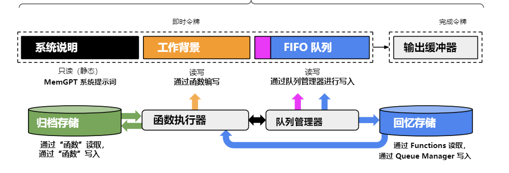

# MemGPT：核心笔记

## 1. 它解决什么问题？

LLM 的上下文窗口固定：长对话、长文档放不下；直接截断会遗忘，扩大窗口成本高，且长上下文模型对中间信息利用不足。

论文的目标不是让模型真正拥有无限记忆，而是实现 **virtual context management**：让模型自己决定什么留在窗口、什么搬到外部、需要时再取回，制造“无限上下文”的错觉。它要保证长期对话的**一致性**与**参与感**。

## 2. 核心办法是什么？

### 2.1 总体架构



论文用操作系统分页作类比：

| 操作系统 | MemGPT |
|---|---|
| 主存 / RAM | 主上下文（模型此刻能看见） |
| 磁盘 | 外部上下文（recall / archival） |
| 换入换出 | 函数调用 |
| 内存不足中断 | 内存压力告警 |
| 继续执行 | `request_heartbeat=true` |

### 2.2 两层记忆

| 部分 | 内容 | 关键点 |
|---|---|---|
| 系统指令 | 控制流程、记忆层级、函数说明 | 只读；告诉模型怎么管理记忆 |
| 工作上下文 | 固定大小的文本便签 | 可读写；存用户事实、偏好等“当前状态” |
| FIFO 队列 | 近期消息、系统告警、函数输入输出 | 队首是被逐出消息的递归摘要 |
| recall storage | 全部历史消息，包括被逐出的 | 通过函数检索；取回后追加到 FIFO 尾部 |
| archival storage | 任意长文本、文档 | 向量检索：`text-embedding-ada-002` + 余弦；分页返回 |

关键：**模型只能直接看到主上下文。** 外部存储里的内容必须先通过函数调用搬进来；archival 正文只描述余弦相似度，未见重排器。

### 2.3 队列管理器：何时换出

- prompt 超过约 **70%**：插入“内存压力”系统消息，提醒模型保存重要信息；
- 超过约 **100%**：逐出约 **50%** 旧消息，用“旧摘要 + 被逐出消息”生成**递归摘要**，放到队首；
- 被逐出的消息没有消失，仍在 recall storage 中，之后可检索回来；
- 递归摘要是“摘要的摘要”，会丢细节、改写原话。

70% / 100% / 50% 是论文实现中的示例阈值，不是理论常数。

### 2.4 函数执行器与 heartbeat

模型可以输出结构化函数调用，例如：

```text
working_context.append("生日是 2 月 7 日")
working_context.replace("男朋友叫 James", "前男友叫 James")
recall_storage.search("six flags")
archival_storage.search("诺贝尔物理学奖", page=2)
```

函数执行器负责解析、校验、执行，把结果写回上下文；运行错误也回传模型。这叫**自编辑**：模型自己决定何时读、写、改，但改的是上下文和外部存储，**不改模型权重**。

控制流的关键是函数调用里的开关 `request_heartbeat=true`：

- **有**：函数执行完立刻再调用模型，可以连续多次检索；
- **无**：本轮结束（yield），等下一个用户消息或系统事件。

因此它能在一次提问中完成多跳检索，例如“查 key A → 得到 key B → 再查 B → 得到最终值”。

### 2.5 对本课题最重要的设计

MemGPT 区分了两类信息：

- **工作上下文**：当前有效状态，可以被覆盖；
- **recall storage**：原始消息，旧事实不会因为覆盖而消失。

这对应本课题要区分的“当前状态”与“原始证据”。但它**没有** `valid_from/valid_to`、版本号、失效标记或冲突检测；旧消息仍可能被检索回来当成当前事实。

## 3. 哪些参数固定、哪些学习得到、哪些未说明？

| 类别 | 内容 |
|---|---|
| 固定 | 系统指令只读；FIFO 先进先出；工作上下文固定大小；archival 用余弦相似度与 `text-embedding-ada-002`；事件驱动；实现中约 70% 告警、100% 刷写、50% 逐出 |
| 学习得到 | **无**。没有训练检索权重、记忆策略或摘要模型 |
| 未说明 | 工作上下文具体大小；完整提示词与函数 schema（正文未给，附录不在本地 PDF）；recall 检索实现与返回条数；分页大小；何时改写事实、以何为准；冲突检测；摘要质量评估；成本与延迟 |

## 4. 用什么题目和指标验证？

### 4.1 测试集与主要结果

| 任务 | 数据/构造 | 指标 | 主要结果 |
|---|---|---|---|
| DMR 长期记忆 | 基于 MSC（Multi-Session Chat）生成问答；答案在早期会话 | 准确率、ROUGE-L | GPT-4 32.1%→**92.5%**；GPT-4 Turbo 35.3%→**93.4%**；GPT-3.5 38.7%→66.9% |
| 开场白 | MSC 人物设定，与人工开场白比较 | SIM-1/3/H | SIM-1/3 与人类相当或更高，SIM-H 低于人类；更冗长，覆盖信息更多 |
| 多文档 QA | NaturalQuestions-Open 50 题 + Wikipedia | 答案准确率（LLM judge） | 文档数增加时固定上下文基线下降，MemGPT 基本不降 |
| 嵌套 KV | 合成 UUID 键值对，0–4 层嵌套 | 准确率 | GPT-4/4 Turbo 基线 3 层降到 0%；MemGPT+GPT-4 可完成 4 层 |

注意：MemGPT 与基线使用相同底层模型，但可用上下文和检索方式不同；这是**系统级比较**，不是单独重排器的比较。DMR 基线看到的是过去五个会话的有损摘要；多文档 QA 中双方共用同一检索器，差别在能否反复检索、翻页。

### 4.2 这些结果能说明什么、不能说明什么

能说明：在**答案层面**，外部记忆与模型自主检索能改善长期一致性、文档问答和多跳检索。

不能说明：

- 没有 Recall@K、MRR、NDCG，无法判断“正确证据是否排得更前”；
- 没有组件消融，无法分离召回、摘要、工作上下文的贡献；
- 没有成本与延迟报告；
- 差异来自整个系统，不能归因于某个排序模块；
- DMR 由 LLM 生成、嵌套 KV 是合成数据、文档 QA 用 LLM judge；
- 本地 PDF 不含附录，完整提示词与函数 schema 无法核实。

### 4.3 对本课题能否参考？

| 用途 | 判断 | 理由 |
|---|---|---|
| 记忆分层架构 | **可参考** | “工作上下文 = 当前状态”“recall = 原始证据”正好对应本课题要分开的两类信息 |
| 上下文预算与压力告警 | 可借鉴 | 阈值提醒模型保存重要信息的工程做法 |
| 模型驱动的多步检索 | 可借鉴 | heartbeat 链式调用说明检索可多轮进行 |
| 证据级排序基线 | **不可** | 输出答案或函数调用，不输出候选排名；archival 只有余弦相似度 |
| 直接采用其测试集 | **不采用** | 都是答案级任务，没有记忆条目级证据标签 |
| 完整复现 | **不做** | 附录提示词/schema 缺失，MSC 环境与成本不匹配 |

## 5. 没解决什么，与本课题是否相关？

- **不是排序器**：没有候选池、加权打分或证据级排名。
- **摘要破坏证据**：递归摘要改写旧消息，难以逐条追溯。
- **自编辑无规则**：论文承认模型能改写事实，但没说“何时改、以何为准、改错怎么办”。
- **没有有效期与冲突处理**：工作上下文可覆盖旧事实，但无版本、失效标记和冲突检测。
- **缺少检索评测**：没有 Recall/MRR/NDCG、组件消融、成本与延迟。
- **与本课题相关**：最有价值的是“当前有效状态”与“原始证据”分层，以及模型自主检索的控制流；不能作为排序基线，也不能把答案级成绩当作检索成绩。

## 6. 复现、借鉴、比较，还是仅作背景？

**仅作背景。** 不完整复现 MemGPT，也不做“分页语义检索”的近似替代；只在相关工作、记忆分层和数据模式设计中引用。

**决策：这篇论文对本课题的用途是——只作记忆分层与检索控制流的架构参照，用来区分“当前有效状态”和“原始证据”，不作检索排序基线，也不采用其答案级测试集作为本课题的检索评测。**


